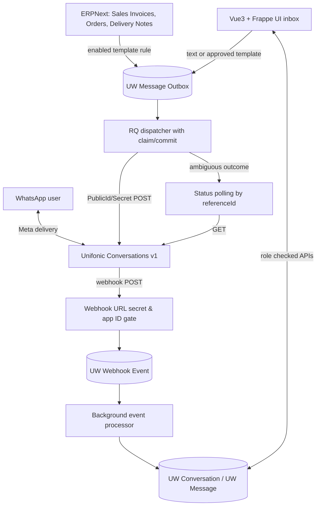

# Architecture & state machines

## Write boundaries
- HTTP request creates outbound UW Message in `Queued`. Once DB transaction commits, RQ dispatch job is queued.
- Dispatcher atomically claims only one message. `Sending` is committed before outbound POST so worker crash is not interpreted as a safe retry.
- On success: `Submitted` unless newer delivery status already exists. On ambiguous failure: `Unknown`, retained for status polling and operator review.
- No code path automatically resends `Unknown` or `Sending` outbound messages.
- Scheduler recovers received/failed events and polls uncertain outbound statuses.

## Security boundaries
- Frappe guest receives only webhook method. Endpoint authenticates before reading JSON; new webhook events use `ignore_permissions=True` in server code after validation.
- All inbox calls require authenticated Unifonic Agent or Manager.
- Managers see all; agents only unassigned or explicitly assigned conversations.
- UW Account, UW Consent, UW Webhook Event and UW Notification Rule are manager-only DocTypes.
- API secrets and webhook tokens are Frappe Password fields; no client-side copies.

## Data model cardinality
- UW Account 1:N UW Conversation / UW Template / UW Consent.
- UW Conversation 1:N UW Message.
- UW Account 1:N UW Webhook Event.
- UW Template 1:N UW Notification Rule.
- UW Consent uniquely identifies `(account, contact)` via `consent_key`.

## Extension points
- Provider message handler may gain safe media download scanning and private File attachments.
- Add Frappe realtime events after confirming per-room audience isolation, or stay with polling.
- Add Lead/Customer linkages as optional references, not as wholesale duplicate CRM records.
- Design separate batch send + compliance gates rather than using conversational API for unsolicited broadcast.
